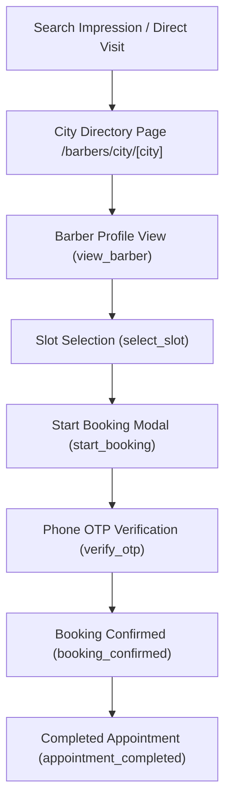

# Trimly: Organic SEO & Conversion Analytics Dashboard

**Platform:** Google Analytics 4 (GA4) + Google Search Console (GSC) + Trimly Audit Stream  
**Target Geo:** India (`en-IN`)  
**Currency:** INR (₹)  

---

## 1. Key Performance Indicators (KPI) Scorecard

| Metric | Measurement Tool | Target (Month 3) | Target (Month 6) | Target (Month 12) |
|---|---|---|---|---|
| **Organic Clicks (Monthly)** | Google Search Console | 5,000 | 25,000 | 100,000+ |
| **City Landing Page Impressions** | Google Search Console | 50,000 | 250,000 | 1,000,000 |
| **GBP Map Pack Top 3 Ranks** | Local Falcon / BrightLocal | 3 cities | 8 cities | 15+ cities |
| **Mobile LCP (Largest Contentful Paint)** | Google PageSpeed / Lighthouse | < 2.0s | < 1.8s | < 1.5s |
| **Organic Booking Conversion Rate** | GA4 Custom Funnel | 3.5% | 5.0% | 6.5% |
| **Organic Barber Lead Signups** | GA4 Event (`barber_signup`) | 25 / month | 100 / month | 350 / month |

---

## 2. Core Conversion Funnel & Event Schema

Trimly measures end-to-end user intent from discovery to completed appointment using GA4 custom events:

### Event Specifications (`src/lib/analytics.js`)

1. **`search_barber`**
   - Trigger: User executes a city or service filter.
   - Parameters: `city`, `service`, `search_term`, `results_count`
2. **`view_barber`**
   - Trigger: User views a canonical barber detail page.
   - Parameters: `barber_id`, `barber_name`, `city`, `price_range`
3. **`select_slot`**
   - Trigger: Customer clicks an open time slot on the calendar.
   - Parameters: `barber_id`, `service_name`, `time_slot`, `day_of_week`
4. **`start_booking`**
   - Trigger: Customer opens the booking confirmation checkout drawer.
   - Parameters: `barber_id`, `service_name`, `price_inr`
5. **`booking_confirmed`**
   - Trigger: Server returns 201 Created for appointment.
   - Parameters: `booking_id`, `barber_id`, `service_name`, `price_inr`, `city`, `currency: "INR"`
6. **`partner_lead_submit`**
   - Trigger: Barber registers shop profile on `/for-barbers`.
   - Parameters: `city`, `services_count`

---

## 3. High-Priority Keyword Watchlist (Rank Tracking)

Track these queries weekly via Google Search Console and rank-tracking software:

### Tier 1: Consumer Discovery (High Volume)
- `"barber near me"` (Local Map Pack)
- `"hair salon near me"` (Local Map Pack)
- `"men haircut near me"` (Local Map Pack)
- `"best barber in Indore"`
- `"hair salon in Bhopal"`
- `"barber shop Mumbai Bandra"`
- `"men salon Bengaluru Indiranagar"`

### Tier 2: Specific Grooming Services
- `"beard trim price India"`
- `"men hair colour salon cost"`
- `"groom wedding salon package near me"`
- `"hair styling salon Indore"`

### Tier 3: B2B Salon Owners
- `"salon booking software India"`
- `"free salon management app India"`
- `"list barbershop online India"`
- `"barber appointment software"`

---

## 4. Technical SEO Health Checklist (Weekly Routine)

- [ ] **Sitemap Coverage:** Verify GSC index coverage for `/sitemap.xml` with zero 404 or 500 errors.
- [ ] **Canonical URL Integrity:** Confirm canonical links match exact protocol and lowercase slugs without trailing slash discrepancies.
- [ ] **Mobile Usability:** Verify Core Web Vitals (INP < 200ms, LCP < 2.5s, CLS < 0.1).
- [ ] **Structured Data Health:** Validate Schema.org markup in Google Rich Results Test for:
  - `Organization` & `WebSite` on homepage
  - `BarberShop` / `LocalBusiness` on canonical barber pages
  - `Article` & `BreadcrumbList` on blog pages
  - `FAQPage` on city, homepage, and FAQ routes.
- [ ] **DPDP Consent Audit:** Review consent logs to ensure Indian users have granted affirmative analytics permission before loading non-essential cookies.

